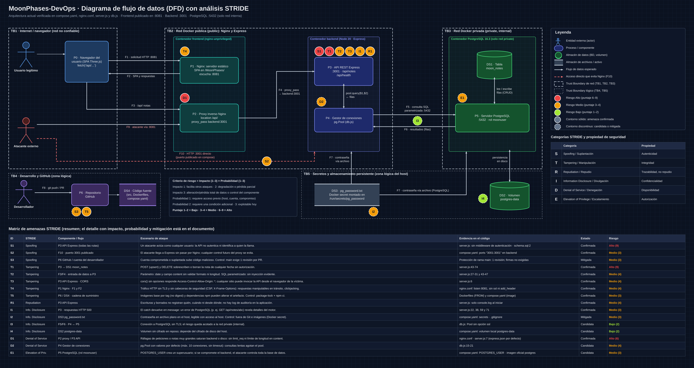

# Análisis STRIDE de MoonPhases-DevOps (DFD)

Archivos de este análisis:

| Archivo | Uso |
|---|---|
| [stride-moonphases.drawio](stride-moonphases.drawio) | Diagrama editable (diagrams.net / extensión de VS Code). |
| [stride-moonphases.png](stride-moonphases.png) | Imagen de 6400×3400 px para el informe. |
| [stride-moonphases.svg](stride-moonphases.svg) | Mismo diagrama en vectorial. |

## 1. Verificación contra el código

| Dato del enunciado | Resultado | Evidencia |
|---|---|---|
| Frontend en el puerto 8080 | **Incorrecto: es 8081.** | `listen 8081` en [nginx.conf](../../frontend/nginx.conf); `8081:8081` en [compose.yaml](../../compose.yaml). El 8080 solo aparece en la guía de DefectDojo. |
| Backend en 3001, PostgreSQL interno en 5432 | Correcto. | [server.js](../../backend/src/server.js), [db.js](../../backend/src/db.js), [compose.yaml](../../compose.yaml). |
| Nginx con proxy `/api/` | Correcto. | `location /api/ { proxy_pass http://backend:3001; }` |
| Redes pública y privada | Correcto. `private` es `internal: true`. El backend está en ambas; PostgreSQL solo en `private`. | [compose.yaml](../../compose.yaml) |
| Secreto de PostgreSQL | Correcto. `pg_password.txt` → `/run/secrets/pg_password`, excluido de Git. | [compose.yaml](../../compose.yaml), [.gitignore](../../.gitignore) |
| Tabla `moon_notes` y CRUD | Correcto: `GET` (lista y por fecha), `POST` (upsert) y `DELETE`. | [schema.sql](../../backend/db/schema.sql), [server.js](../../backend/src/server.js) |
| Three.js y Vite en el frontend | Correcto. El frontend llama a `/api` con rutas relativas. | [NotesPanel.ts](../../frontend/src/components/NotesPanel.ts) |

No se dibujó AWS ni otros servicios. Aunque el repositorio tiene variables `AWS_*` en GitHub, el código no implementa ningún despliegue a AWS. Tampoco se dibujó el runner de GitHub Actions, que aún no está en la rama principal. El flujo F8 representa solo el empuje de código al repositorio.

## 2. Componentes y flujos

### Actores externos
- **Usuario legítimo:** usa el navegador (P0).
- **Atacante externo:** puede ir por Nginx (F9) o directamente al puerto 3001 (F10).
- **Desarrollador:** sube código a GitHub (F8).

### Procesos
- **P0** Navegador con la SPA de Three.js.
- **P1** Nginx sirviendo la SPA estática en `/MoonPhases/`.
- **P2** El mismo Nginx actuando como proxy inverso de `/api/`.
- **P3** API REST Express.
- **P4** Gestor de conexiones `pg.Pool`.
- **P5** Servidor PostgreSQL.
- **P6** Repositorio GitHub.

### Almacenes
- **DS1** Tabla `moon_notes`.
- **DS2** Volumen `postgres-data`.
- **DS3** `pg_password.txt` y su secreto montado.
- **DS4** Código fuente.

### Flujos

| ID | Flujo | Nota |
|---|---|---|
| F1 / F2 | Navegador ↔ Nginx (P1) | HTTP en el puerto 8081: solicitud y SPA estática. |
| F3 | Navegador → proxy `/api/` (P2) | Operaciones sobre notas. |
| F4 | Proxy → Express | `proxy_pass http://backend:3001`. |
| F5 / F6 | Pool → PostgreSQL y retorno | SQL parametrizado (`$1`, `$2`), sin TLS. |
| F7 | DS3 → backend y PostgreSQL | La contraseña se entrega como archivo. |
| F8 | Desarrollador → GitHub | `git push` o PR. |
| F9 | Atacante → proxy | Por el camino normal (8081). |
| F10 | Atacante → Express directo | Puerto 3001 publicado en el host. Línea roja discontinua: es un flujo confirmado en `compose.yaml`, pero evita el control de Nginx. |

### Trust Boundaries

| TB | Qué separa | Tipo |
|---|---|---|
| TB1 | Internet y navegador frente al host de la aplicación. | Frontera de red real. Cruzan F1, F2, F3, F9 y F10. |
| TB2 | Red Docker `public` (Nginx y Express). | Frontera de red real. |
| TB3 | Red Docker `private` (`internal: true`). | Frontera de red real. La cruza F5/F6. |
| TB4 | Desarrollo y repositorio GitHub. | **Zona lógica**, no es una red. |
| TB5 | Secretos y almacenamiento persistente. | **Zona lógica** del sistema de archivos del host. |

Ningún límite se superpone con otro. El backend pertenece a TB2 y también está conectado a la red de TB3; el dibujo lo ubica en TB2 y el flujo F5 cruza hacia TB3.

## 3. Criterio de riesgo

**Riesgo = Impacto (1–3) × Probabilidad (1–3).** Puntaje 1–2 = Bajo, 3–4 = Medio, 6–9 = Alto.

| Nivel | Impacto | Probabilidad |
|---|---|---|
| 1 | Facilita otros ataques; no hay pérdida directa. | Requiere acceso previo (host, cuenta o compromiso del backend). |
| 2 | Degradación del servicio o pérdida parcial de datos. | Requiere una condición adicional (estar en la ruta de red, un sitio que visita la víctima, etc.). |
| 3 | Alteración o pérdida total de los datos, o control del componente. | Explotable hoy desde la red, sin precondiciones. |

**Estados:** *Confirmada* (evidencia directa en código o configuración), *Candidata* (depende de una condición no verificada), *Mitigada* (hay un control, con riesgo residual).

Los puntajes difieren en algunos casos del registro anterior ([stride-register.md](../threat-model/stride-register.md)). Por ejemplo, S2 (puerto 3001) pasa de severidad Alta a Media. Hoy Nginx no aplica ningún control que se pueda evadir, así que el puerto publicado amplía la superficie pero no concede ninguna capacidad nueva. Si se añaden límites o autenticación en el proxy, la probabilidad sube a 3 y el puntaje a 6.

## 4. Matriz de amenazas

| ID | STRIDE | Componente | Escenario concreto | Evidencia | Impacto | Prob. | Riesgo | Mitigación recomendada |
|---|---|---|---|---|---|---|---|---|
| **S1** (S-01) | Spoofing | P3 API Express | Cualquiera actúa como cualquier usuario: la API no autentica ni identifica al llamante. | [server.js](../../backend/src/server.js) sin middleware de autenticación; [schema.sql:2](../../backend/db/schema.sql) | 3 | 3 | **Alto (9)** | Autenticación (sesión o JWT) y autorización por recurso; como mínimo, token en `POST` y `DELETE`. |
| **S2** (S-02) | Spoofing | F10, puerto 3001 | El atacante llega a Express sin pasar por Nginx; cualquier control futuro del proxy se evita. | [compose.yaml](../../compose.yaml): `ports: "3001:3001"` | 1 | 3 | Medio (3) | Quitar `ports` del backend; el acceso debe pasar por Nginx. |
| **S3** | Spoofing | P6 GitHub | Cuenta del desarrollador comprometida o suplantada sube código malicioso. | La rama `main` exige 1 revisión por PR y `enforce_admins`; no exige commits firmados. | 3 | 1 | Medio (3) | Exigir commits firmados y 2FA; revisar acciones de terceros y fijarlas por SHA. |
| **T1** (T-01) | Tampering | P3 → DS1 | `POST` (upsert) y `DELETE` sobrescriben o borran la nota de cualquier fecha sin autorización. | [server.js:43-74](../../backend/src/server.js) | 3 | 3 | **Alto (9)** | La misma que S1; además, copia de seguridad periódica de `postgres-data`. |
| **T2** (T-02) | Tampering | F3/F4 → P3 | `:date` y `content` llegan sin validar formato ni longitud. Las consultas parametrizadas son un control: no hay inyección SQL evidente. | [server.js:27-31, 43-47](../../backend/src/server.js) | 2 | 2 | Medio (4) | Validar `date` (`YYYY-MM-DD`) y limitar la longitud de `content`. |
| **T3** (T-05) | Tampering | P3, CORS | `cors()` sin opciones responde `Access-Control-Allow-Origin: *`; cualquier sitio puede invocar la API desde el navegador de la víctima. | [server.js:6](../../backend/src/server.js) | 2 | 2 | Medio (4) | `cors({ origin: <origen del frontend> })`. |
| **T4** (T-03, I-02) | Tampering | P1 Nginx, F1/F2 | HTTP sin TLS y sin cabeceras de seguridad: respuestas manipulables en tránsito; clickjacking. | [nginx.conf](../../frontend/nginx.conf): `listen 8081`, sin `ssl` ni `add_header` | 2 | 2 | Medio (4) | TLS en Nginx; CSP, `X-Frame-Options`, `X-Content-Type-Options`, `Referrer-Policy` y HSTS. |
| **T5** (T-04) | Tampering | P6 / DS4, cadena de suministro | Las imágenes base se referencian por tag, no por digest; una imagen o dependencia alterada llegaría al artefacto. Control: `package-lock.json` y `npm ci`. | Dockerfiles (`FROM`), [compose.yaml](../../compose.yaml) | 3 | 1 | Medio (3) | Fijar imágenes por digest; Trivy en el pipeline (ya configurado). |
| **R1** (R-01) | Repudiation | P3 API Express | Las escrituras y borrados no registran quién, cuándo ni desde dónde. | [server.js](../../backend/src/server.js): solo `console.log` al iniciar | 2 | 2 | Medio (4) | Log estructurado de `POST` y `DELETE` (fecha, IP, identidad cuando exista S1). |
| **I1** (I-01) | Info. Disclosure | P3, respuestas 500 | El `catch` devuelve `err.message`; por ejemplo `GET /api/notes/abc` revela el mensaje de PostgreSQL. | [server.js:22, 38, 59, 71](../../backend/src/server.js) | 1 | 3 | Medio (3) | Registrar el error en el servidor y responder un mensaje genérico. |
| **I2** (I-05) | Info. Disclosure | DS3 `pg_password.txt` | La contraseña está en un archivo plano del host, legible por quien tenga acceso al host. Control: fuera de Git y de las imágenes (Docker secret). | [compose.yaml](../../compose.yaml), [.gitignore](../../.gitignore) | 3 | 1 | Medio (3) | Permisos `600` en el archivo; gestor de secretos en un despliegue real. |
| **I3** (I-03) | Info. Disclosure | F5/F6, P4 ↔ P5 | La conexión a PostgreSQL no usa TLS; el riesgo queda acotado a la red `private` (`internal`). | [db.js:15-21](../../backend/src/db.js) | 2 | 1 | Bajo (2) | Activar `ssl` si PostgreSQL deja de estar en una red aislada. |
| **I4** (I-04) | Info. Disclosure | DS2 `postgres-data` | El volumen no está cifrado en reposo; depende del cifrado de disco del host. | [compose.yaml](../../compose.yaml) | 2 | 1 | Bajo (2) | Cifrado de disco en el host. |
| **D1** (D-01) | Denial of Service | P2 proxy y P3 | Ráfagas de peticiones o notas muy grandes saturan el backend o el disco. Nginx limita a 1 MB y Express a 100 KB por defecto, pero no hay límite de tasa ni de longitud de `content`. | [nginx.conf](../../frontend/nginx.conf), [server.js:7](../../backend/src/server.js) | 2 | 3 | **Alto (6)** | `limit_req` y `client_max_body_size` en Nginx; límite de longitud en `content`. |
| **D2** | Denial of Service | P4 `pg.Pool` | El pool usa valores por defecto de `pg` (máximo 10 conexiones, sin timeout de conexión): consultas lentas agotan las conexiones. | [db.js:15-21](../../backend/src/db.js) | 2 | 2 | Medio (4) | Definir `max`, `connectionTimeoutMillis` y `statement_timeout`. |
| **E1** | Elevation of Privilege | P5 PostgreSQL (rol `moonuser`) | `POSTGRES_USER` crea un superusuario en la imagen oficial; si se compromete el backend, el atacante controla toda la base de datos. | [compose.yaml](../../compose.yaml): `POSTGRES_USER`; comportamiento de la imagen oficial `postgres` | 3 | 1 | Medio (3) | Rol de aplicación con permisos mínimos sobre `moon_notes`. |

Entre paréntesis aparece el ID equivalente del catálogo anterior ([threat-model.md](../threat-model/threat-model.md)). S3, D2 y E1 son nuevos.

**Sobre E (Elevation of Privilege):** en la API no hay escalamiento de privilegios porque no hay roles: quien llega ya tiene el máximo permiso, y eso se recoge en S1 y T1. Por eso la única amenaza E es la de PostgreSQL (E1), condicionada a que el backend ya esté comprometido. Es un caso Candidata, no una vulnerabilidad confirmada.

## 5. Controles existentes

Estos controles no deben retirarse:

- Consultas SQL parametrizadas en todas las operaciones.
- PostgreSQL no se publica en el host y está en una red `internal: true`.
- Procesos sin root: `USER node` en el backend y `nginx-unprivileged` en el frontend.
- Contraseña de PostgreSQL como Docker secret, fuera de Git y de las imágenes.
- Dependencias fijadas por lockfile e instaladas con `npm ci`.
- Rama `main` protegida: exige 1 revisión y se aplica a administradores.

## 6. Por qué cada amenaza está donde está

- **Express (P3):** concentra S1, T1, T2, T3, I1 y R1, porque la lógica de autenticación, validación, CORS, errores y registro vive en `server.js`.
- **Nginx (P1/P2):** T4 va en P1 por el canal HTTP y las cabeceras; D1 va en el proxy porque es donde se debería limitar la tasa.
- **F10:** S2 se dibuja sobre el flujo directo al puerto 3001, no sobre un componente, porque la amenaza es el camino mismo.
- **Pool (P4):** D2 está ahí porque el agotamiento de conexiones se produce en el pool.
- **F5/F6:** I3 va entre ambos flujos porque afecta a la conexión en las dos direcciones.
- **PostgreSQL (P5):** E1 está en el servidor, donde reside el rol.
- **Activos:** I2 (secreto), I4 (volumen), S3 y T5 (repositorio y cadena de suministro) se colocan en su almacén o proceso.

## 7. Arquitectura actual y mejoras propuestas

El diagrama muestra **solo la arquitectura actual**. Las mitigaciones de la tabla son propuestas y no están implementadas. Las más rentables, en orden:

1. Quitar `ports: "3001:3001"` del backend (S2).
2. Respuestas de error genéricas (I1).
3. Autenticación y autorización (S1, T1, E1 parcialmente).
4. `limit_req`, validación de entrada y CORS restringido (D1, T2, T3).
5. TLS y cabeceras de seguridad en Nginx (T4).

La validación posterior con SAST y DAST (Semgrep, Trivy y ZAP, ya integrados en el pipeline) debe asociar cada hallazgo a uno de estos IDs o registrarlo como nuevo.

## 8. Cómo se generaron los archivos

El `.drawio`, el `.svg` y el `.png` salen de un mismo modelo, así que sus posiciones coinciden. Verificado: el XML del `.drawio` y el del `.svg` son válidos, y una comprobación automática no detectó textos ni figuras superpuestos. **No se abrió el `.drawio` en diagrams.net**, porque no hay un draw.io disponible en este entorno. El `.png` se renderizó a partir del `.svg`.

En draw.io, las etiquetas de los flujos son cuadros de texto independientes, no etiquetas de las flechas. Si mueves una flecha, mueve también su etiqueta. El color de la cuadrícula lo define el tema del editor.
